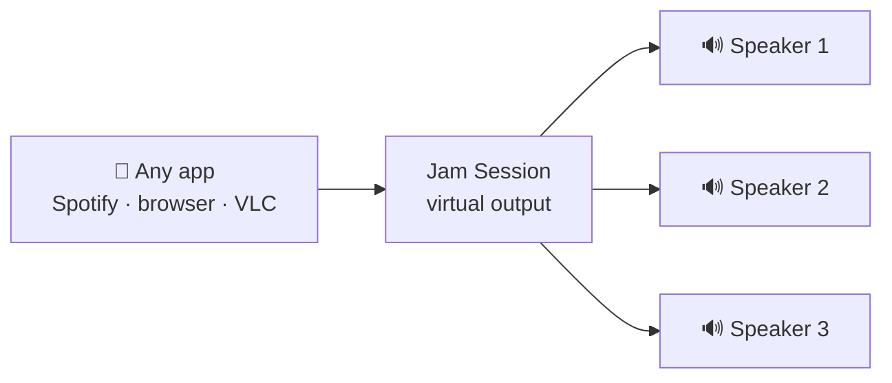

<div align="center">

# 🎶 bt-jam

### Turn every Bluetooth speaker you own into one sound system.

Play the same music through **multiple Bluetooth speakers at once** on Linux,<br>
from a friendly terminal menu, built **entirely from shell scripts**.

[](https://github.com/zynssam/bluetooth-jam/actions/workflows/tests.yml)


[](LICENSE)

</div>

---

## The problem

A computer normally sends audio to **one** Bluetooth speaker at a time. If you have
two or three speakers lying around, you can't make them play the same song
together, at a party, across rooms, or outside.

**bt-jam removes that limit.** Pick your speakers and press go. Every app plays
through all of them.

```text
  ♪ ♫  BLUETOOTH JAM SESSION  ♫ ♪
  make all your speakers play together
  ────────────────────────────────────────────────────────
  ● JAM IS LIVE on 3 speaker(s)   volume 80%
  ────────────────────────────────────────────────────────
   1) ⚡ Quick Jam — find speakers & start playing
   2) 🔍 Find & connect speakers
   3) ▶  Start the jam (with connected speakers)
   4) 🎚  Session controls — volume, mute, stop
   5) 🔧 Manage speakers — add, remove, swap
   6) 🎵 Play music / test sound
   7) 📋 Status
   8) ❓ Help
   0) 🚪 Quit
```

## ✨ Features

- ⚡ **One-button Quick Jam**: scan, pick speakers (`a` = all), connect and start, in under a minute
- 🔍 **Smart discovery**: shows only audio devices, each marked *new / paired before / connected / in the jam*
- 🎚 **Session control**: volume up/down, exact volume, mute everything, stop
- ⚖ **Per-speaker balance**: make one speaker louder or quieter than the others
- ⏱ **Echo fix**: add a small delay to a speaker that plays ahead
- 🔁 **Hot-swap without stopping the music**: add, remove or swap a speaker mid-song
- 🔌 **Dropout recovery**: reconnect a speaker that went out of range
- 🔔 **"Which one is which?"**: beep a single speaker (the tone is generated in pure shell)
- 🎵 **Built-in player**: play a file or a whole folder, or just use Spotify, a browser or VLC
- 🧪 **95 automated tests** that run without any Bluetooth hardware

## 🚀 Quick start

```bash
git clone https://github.com/zynssam/bluetooth-jam.git
cd bluetooth-jam
./install.sh      # checks your system and adds a `bt-jam` command
bt-jam            # or ./jam.sh
```

Then choose **1) Quick Jam**, switch your speakers on, type their numbers, and
you're done. 🎉

### Requirements

| Needed | Debian / Ubuntu | Fedora | Arch |
|---|---|---|---|
| BlueZ (`bluetoothctl`) | `bluez` | `bluez` | `bluez bluez-utils` |
| `pactl` / `paplay` | `pulseaudio-utils` | `pulseaudio-utils` | `libpulse` |
| PipeWire Bluetooth* | `libspa-0.2-bluetooth` | *(included)* | *(included)* |
| *Optional:* music player | `mpv` | `mpv` | `mpv` |

\* PipeWire systems only. `./check_deps.sh` detects your distro and prints the exact command.

> Run bt-jam as your **normal user**, not with `sudo`. The sound server belongs to your desktop session.

## 🕹 Usage

| Command | What it does |
|---|---|
| `./jam.sh` | Open the menu |
| `./jam.sh --status` | Show the jam, its speakers, levels and delays |
| `./jam.sh --stop` | Stop the jam and send audio back to your normal output |
| `./check_deps.sh` | Check requirements |
| `./diagnose.sh` | Report on why a speaker won't play (saved to `bt-jam-report.txt`) |
| `./install.sh --uninstall` | Remove the `bt-jam` command |

Closing the menu **leaves the jam playing**, so you can close the terminal and keep partying.

## 🧠 How it works



1. **Bluetooth:** `bluetoothctl` scans, pairs, trusts and connects each speaker.
   If the music (A2DP) channel doesn't open, bt-jam opens it directly through
   BlueZ's D-Bus `ConnectProfile`. If the speaker's sound card shows up switched
   off or in phone-call mode, bt-jam reads the modes the card offers and
   switches to the best music mode.
2. **Combining:** `pactl load-module module-combine-sink` creates one virtual
   output that copies the sound to every speaker. It becomes the default output,
   and apps that are already playing are moved onto it.
3. **Hot-swapping:** to change the speaker list, bt-jam builds a *new*
   combined output first, moves the music onto it, and only then removes the old
   one. Volume and mute carry over, and the music never stops.
4. **Stopping:** audio goes back to the output you were using before the jam.

This works with **PulseAudio** and with **PipeWire** (through `pipewire-pulse`).

## 📁 Project structure

```text
bluetooth-jam/
├── jam.sh              # entry point: menu + --status / --stop
├── install.sh          # chmod + `bt-jam` shortcut
├── check_deps.sh       # requirement checker with distro-specific install hints
├── diagnose.sh         # troubleshooting report for a speaker that won't play
├── lib/
│   ├── common.sh       # colours, prompts, state, logging
│   ├── bluetooth.sh    # scan / pair / connect / disconnect
│   ├── audio.sh        # sinks, volume, mute, stream moving, delay, test tone
│   ├── session.sh      # build / rebuild / stop the jam
│   ├── menus.sh        # all menus
│   └── player.sh       # background music player (mpv/ffplay/cvlc/pw-play/paplay)
└── tests/
    └── run_tests.sh    # 95 checks against simulated bluetoothctl + pactl
```

Every part of the program is a `.sh` file. There are no other languages and no GUI frameworks.

## 🧪 Testing

```bash
./tests/run_tests.sh
```

The test suite creates fake `bluetoothctl`, `pactl` and `paplay` commands that act
like a PipeWire system with several speakers. One of them is out of range, some
connect without a working music channel, and there's a mouse that should be ignored. The tests cover discovery, connecting,
the jam, add/remove/swap while music plays, a speaker dropping out, volume,
mute, delay, the music player, stopping, and full menu sessions typed in as a
user would. GitHub Actions runs them and ShellCheck on every push.

## 💡 Tips & troubleshooting

- **How many speakers?** Most built-in adapters handle **2–4**. A USB Bluetooth dongle helps with more.
- **Slight echo in one room?** Bluetooth speakers each add a slightly different delay.
  Go to *Session controls → Fix echo* and add 50–200 ms to the speaker that sounds ahead.
  You won't notice the difference between separate rooms.

| Problem | Try |
|---|---|
| Speaker not found | Disconnect it from your phone, hold its Bluetooth button until it flashes, then scan again. Or pick "show ALL devices" |
| "Connected, but Linux never got a sound output" | bt-jam already tries to open the music channel and switch modes. If it still fails, your adapter may have hit its limit (a USB dongle helps), or pairing didn't finish (*Manage speakers → Forget*, then add it again). Run `./diagnose.sh` and open an issue with the report |
| Choppy sound | Use fewer speakers, move them closer, or add a dongle |
| "No Bluetooth adapter" | `sudo systemctl enable --now bluetooth` |
| "Can't reach the sound server" | Don't use `sudo`. Run from your desktop session |

Logs are kept in `~/.local/state/bt-jam/jam.log`.

## 🤝 Contributing

Issues and pull requests are welcome. Please keep everything in shell script,
and make sure `./tests/run_tests.sh` and `shellcheck` pass.

## 📄 License

[MIT](LICENSE). Bring your dusty old speakers back to life. 🔊
